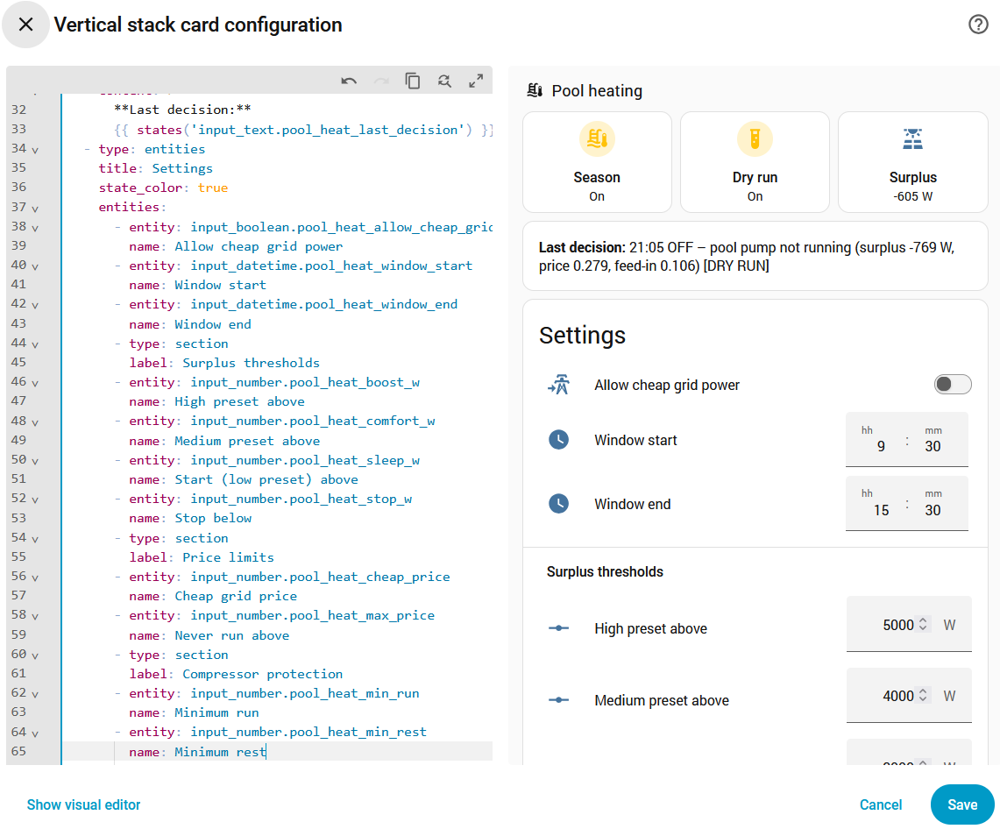
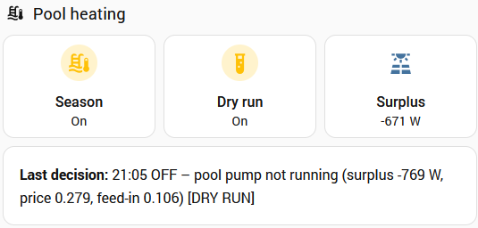
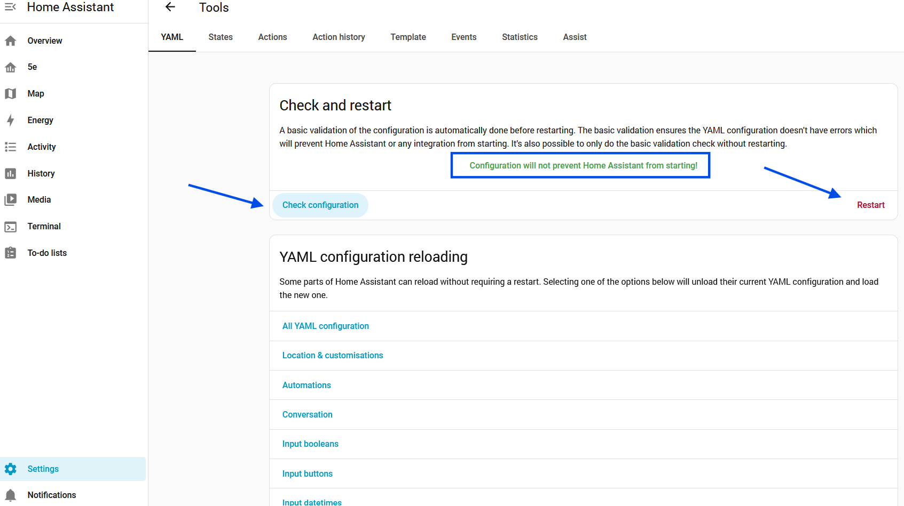
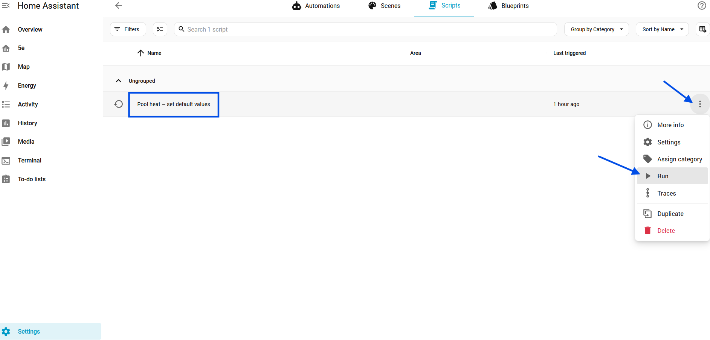
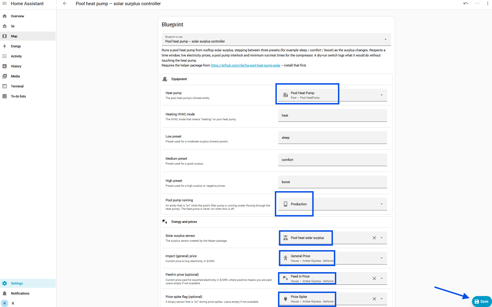
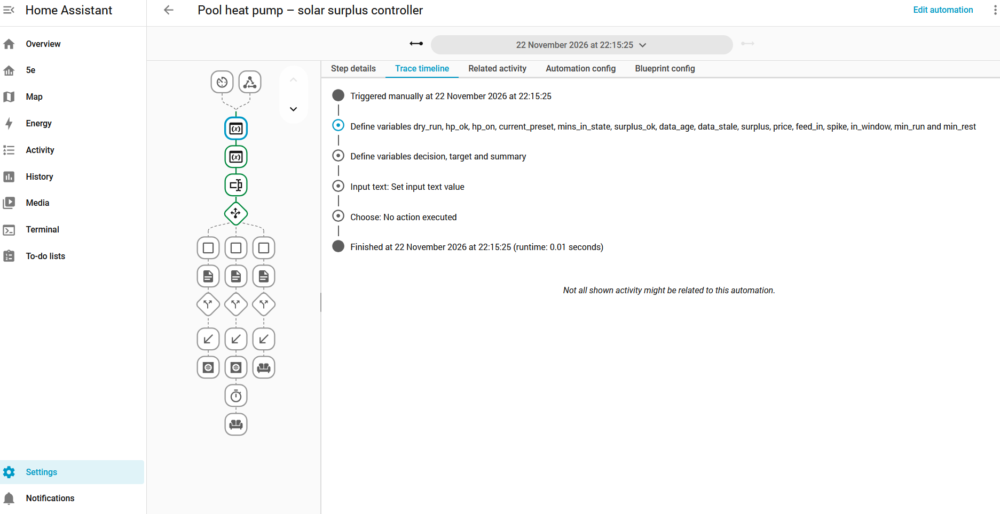

# Pool heat pump – solar surplus controller for Home Assistant

Run your pool heat pump on spare rooftop solar instead of a fixed timer.

The controller watches how much solar you're exporting, live electricity prices and whether the pool pump is running. It then switches the heat pump on and off and steps it between three power presets (for example *sleep / comfort / boost*), so it uses as much of your surplus as possible without pulling expensive power from the grid.

> **Status: v0.1.0 pre-release.** The decision logic has been tested in dry-run mode only (logging what it would do without controlling the heat pump). A full release will follow after a season of real use. Please read [Safety](#safety) before turning dry run off.


<!-- SCREENSHOT: the Pool heating card on a sunny day, heat pump running -->

---

## Contents

- [How it works](#how-it-works)
- [What you need](#what-you-need)
- [Installation](#installation)
- [Testing with dry run](#testing-with-dry-run)
- [Tuning](#tuning)
- [Going live](#going-live)
- [Pool cover reminder](#pool-cover-reminder)
- [Troubleshooting](#troubleshooting)
- [Safety](#safety)
- [Files in this repo](#files-in-this-repo)

---

## How it works

### Solar surplus

The package creates a sensor, **Pool heat solar surplus**:

```
surplus = heat pump power − net grid power
```

Net grid power is positive when importing and negative when exporting. Adding the heat pump's own draw back in is what makes this work: once the heat pump is running it soaks up the export, so export alone would drop to zero and the heat pump would switch itself off again.

| Situation | Surplus |
|---|---|
| Exporting 2 kW, heat pump off | 0 − (−2000) = **2000 W** available |
| Heat pump drawing 4 kW, still exporting 0.5 kW | 4000 + 500 = **4500 W** (solar covers it all) |
| Heat pump drawing 4 kW, importing 1 kW | 4000 − 1000 = **3000 W** (grid covers 1 kW) |

Other household loads (air conditioning, oven, washing machine…) reduce your export, so they lower the surplus automatically. No separate rules are needed for them.

### Decision order

Every 5 minutes, and immediately whenever the season switch, dry run, pool pump or import price changes, the controller works down this list and stops at the first match:

| # | Check | Result |
|---|---|---|
| 1 | Heating season switch is off | **Off** (immediately) |
| 2 | Pool pump not running | **Off** (immediately) |
| 3 | Outside the time window | **Off** (immediately) |
| 4 | Price spike, or import price above your maximum | **Off** (immediately) |
| 5 | Surplus sensor unavailable | **Off** (after minimum run time) |
| 6 | Meter data stale (optional freshness check) | **Off** (after minimum run time) |
| 7 | Import or feed-in price negative | **High preset** |
| 8 | Surplus ≥ high threshold (default 5000 W) | **High preset** |
| 9 | Surplus ≥ medium threshold (default 4000 W) | **Medium preset** |
| 10 | Surplus ≥ start threshold (default 3000 W) | **Low preset** |
| 11 | Already running and surplus ≥ stop threshold (default 2000 W) | **Low preset** (keeps running) |
| 12 | "Allow cheap grid power" on and import price ≤ cheap price | **Low preset** |
| 13 | Otherwise | **Off** (after minimum run time) |

### When data goes missing

- **Meter goes unavailable:** the surplus sensor goes unavailable (rule 5), so the heat pump stops after its minimum run time and won't restart until data returns.
- **Meter freezes but keeps showing its last values:** this is the dangerous case, because a frozen "5 kW export" would keep the heat pump running through cloud. The optional **meter freshness check** (rule 6) catches it: pick a raw meter sensor that reports regularly, and if it hasn't reported within the maximum age, the controller treats the data as stale. It uses Home Assistant's `last_reported` time, which updates on every report even when the value is unchanged.
- **Price sensor unavailable:** treated as a very high price, so the heat pump switches off immediately (rule 4).

The gap between the start (3000 W) and stop (2000 W) thresholds stops the heat pump flicking on and off when the surplus hovers around one value.

### Compressor protection

- **Minimum run time** (default 20 min): once started, it isn't switched off for lack of solar until it has run this long. Safety reasons (1–4 above) still switch it off immediately.
- **Minimum rest time** (default 10 min): after stopping, it won't restart until it has rested this long.

### Seeing what it decided

Every run writes a one-line summary to **Pool heat – last decision**, for example:

```
11:35 COMFORT – good surplus (surplus 4320 W, price 0.054, feed-in 0.031)
```

Every actual change (turning on or off, or changing preset) also goes into the Activity log.


<!-- SCREENSHOT: last decision text plus Activity log entries -->

---

## What you need

- **Home Assistant 2024.10** or newer.
- **A pool heat pump as a `climate` entity** with an "off" mode, a heating mode and at least three presets. Developed on a Fairland InverX via [Tuya Local](https://github.com/make-all/tuya-local) (presets `sleep`, `comfort`, `boost`). Other heat pumps work if they expose presets. Set the preset names in the blueprint.
- **Heat pump power** in watts. A CT clamp on its circuit works well.
- **Signed net grid power** in watts (positive = import, negative = export). If your meter gives an unsigned power plus an export flag, see [Building a signed net grid sensor](#building-a-signed-net-grid-sensor).

  *Example:* the [Ourtop 5-channel CT meter kit](https://github.com/r5e/ha-ourtop-atms100115-energy-meter) provides both of these: its net grid power sensor (recipe 1) and a CT channel on the heat pump circuit.
- **An import price sensor** in $/kWh. Developed with [Amber Express](https://github.com/hass-energy/amber-express).
- *Optional:* a feed-in price sensor ($/kWh, positive = you are paid) and a price spike binary sensor.
- **An entity that is "on" while the pool pump runs.** The heat pump needs water flowing through it. This could be a pump switch, a smart plug, or (as in the original setup) the chlorinator's run switch.

---

## Installation

### 1. Enable packages (if you haven't already)

In `configuration.yaml`:

```yaml
homeassistant:
  packages: !include_dir_named packages
```

Then create a `packages` folder next to `configuration.yaml`.

### 2. Install the helper package

1. Copy [`packages/pool_heat_pump_helpers.yaml`](packages/pool_heat_pump_helpers.yaml) to `/config/packages/`.
2. **Edit the surplus sensor** near the bottom of the file. Replace `sensor.pool_heat_pump_power` and `sensor.net_grid_power` with your own sensors. Each appears twice.
3. Check your configuration (**Developer Tools → YAML → Check configuration**), then restart Home Assistant.


<!-- SCREENSHOT: Developer Tools > YAML > Check configuration showing "Configuration will not prevent Home Assistant from starting" -->

### 3. Load the default values

Go to **Settings → Automations & scenes → Scripts**, find **Pool heat – set default values**, click **⋮ → Run**.

This sets the starting thresholds, a 09:30–15:30 window, and turns **dry run on**. Changes you make afterwards are kept across restarts.


<!-- SCREENSHOT: Scripts list with the ⋮ menu open on "Pool heat – set default values" -->

### 4. Import the blueprint

[](https://my.home-assistant.io/redirect/blueprint_import/?blueprint_url=https%3A%2F%2Fgithub.com%2Fr5e%2Fha-pool-heat-pump-solar%2Fblob%2Fmain%2Fblueprints%2Fautomation%2Fpool_heat_pump_solar_controller.yaml)

Or go to **Settings → Automations & scenes → Blueprints → Import blueprint** and paste:

```
https://github.com/r5e/ha-pool-heat-pump-solar/blob/main/blueprints/automation/pool_heat_pump_solar_controller.yaml
```

### 5. Create the automation

Open the blueprint, click **Create automation**, and fill in:

| Input | What to choose |
|---|---|
| Heat pump | Your heat pump's `climate` entity |
| Heating HVAC mode | Usually `heat` |
| Low / Medium / High preset | Your heat pump's preset names, lowest to highest power |
| Pool pump running | Entity that's on while water is flowing |
| Solar surplus sensor | Leave as `sensor.pool_heat_solar_surplus` |
| Import price | Your current import price sensor ($/kWh) |
| Feed-in price | Optional |
| Price spike flag | Optional |
| Meter freshness check | Recommended: a raw power sensor from your meter (not a template sensor built from it) |
| Maximum data age | About 3–5× your meter's update interval (default 5 min) |
| Helpers | Leave as defaults unless you renamed them |


<!-- SCREENSHOT: the "Create automation" form from the blueprint, Equipment and Energy sections filled in -->

### 6. Add the dashboard card

Copy [`dashboard/pool_heating_card.yaml`](dashboard/pool_heating_card.yaml) into a new card (**Edit dashboard → Add card → Manual**).

---

## Testing with dry run

With **dry run on**, the controller makes every decision and logs it, but never touches the heat pump.

1. Turn on **Pool heating season**. Leave **dry run** on.
2. Check **Last decision** on the card. It should update within a few seconds. At night it will say something like `OFF – pool pump not running` or `OFF – outside time window`.
3. On a sunny day, watch it through the window. Activity log entries will read `would turn ON (comfort)`, `would change preset comfort → boost` and so on.
4. For the full reasoning behind any run, open the automation and click **⋮ → Traces**.


<!-- SCREENSHOT: an automation trace showing the variables and the chosen path -->

---

## Tuning

The default thresholds are starting points. To set them properly:

1. With the pool pump running, switch the heat pump on manually at each preset and note its steady power draw.
2. Set each threshold a little below that preset's draw. Then the preset is only chosen when solar can cover most of it.
3. Keep the **stop** threshold well below the **start** threshold to avoid short cycling.

| Setting | Default | Notes |
|---|---|---|
| High preset above | 5000 W | |
| Medium preset above | 4000 W | |
| Start (low preset) above | 3000 W | |
| Stop below | 2000 W | Only applies once running |
| Cheap grid price | 0.10 $/kWh | Only used if "Allow cheap grid power" is on |
| Never run above | 0.40 $/kWh | Hard ceiling, overrides solar |
| Minimum run | 20 min | |
| Minimum rest | 10 min | |
| Window | 09:30–15:30 | Keep it within your pool pump's schedule |

All of these can be changed from the card. No restart is needed.

---

## Going live

Before turning **dry run off**:

- **Remove any other schedules** for the heat pump (for example timers in the manufacturer's app), so the two don't fight.
- **Check the pool pump runs for the whole window.** The controller won't start the heat pump without flow, but extend your pump schedule if the window runs past it.
- **Set the heat pump's own target temperature** on the unit or its thermostat card. The controller decides *when* to heat, and the heat pump still stops at its set point.

---

## Pool cover reminder

A second, optional blueprint sends a reminder before sunset if the pool is still uncovered during heating season. A cover keeps the day's heat in overnight.

[](https://my.home-assistant.io/redirect/blueprint_import/?blueprint_url=https%3A%2F%2Fgithub.com%2Fr5e%2Fha-pool-heat-pump-solar%2Fblob%2Fmain%2Fblueprints%2Fautomation%2Fpool_cover_sunset_reminder.yaml)

You'll need some way of detecting the cover: a contact sensor, a camera-based sensor, or even an `input_boolean` you toggle yourself. Set **State meaning "pool uncovered"** to match your sensor.

---

## Troubleshooting

| Symptom | Likely cause |
|---|---|
| Last decision says `surplus unknown` | One of the sensors in the surplus template is unavailable, or the entity IDs weren't changed in the package |
| Always `outside time window` | The defaults script hasn't been run, so the window times are empty |
| Always `pool pump not running` | Wrong entity chosen for "Pool pump running", or it isn't "on" while the pump runs |
| Surplus looks wrong at night | Expected: with no solar, surplus is negative (you're importing) |
| Surplus doesn't rise when exporting | Your net grid sensor isn't signed, so it doesn't go negative on export |
| Always `meter data stale` | The freshness sensor doesn't report often enough. Check its `last_reported` in Developer Tools → Template (`{{ states.sensor.your_sensor.last_reported }}`), or raise the maximum data age |
| Heat pump turns on but preset doesn't change | The preset names in the blueprint don't match your heat pump's `preset_modes` attribute |

### Building a signed net grid sensor

If your meter reports power as a positive number plus a separate export flag, create a **Template sensor** helper (unit W, device class Power, state class Measurement):

```jinja

{{ -p if is_state('binary_sensor.your_grid_export', 'on') else p }}
```

---

## Safety

This controls a high-power appliance. Use it at your own risk.

- The controller **never starts the heat pump unless the pool pump entity is on**. Make sure that entity is reliable. A heat pump without water flow will raise a flow fault and may be damaged.
- It does not replace your heat pump's own protections (flow switch, pressure switches, defrost).
- Test thoroughly in dry run before going live.

---

## Files in this repo

| File | Purpose |
|---|---|
| `packages/pool_heat_pump_helpers.yaml` | Helpers, surplus sensor and defaults script |
| `blueprints/automation/pool_heat_pump_solar_controller.yaml` | The controller |
| `blueprints/automation/pool_cover_sunset_reminder.yaml` | Optional cover reminder |
| `dashboard/pool_heating_card.yaml` | Dashboard card (built-in cards only) |
| `CHANGELOG.md` | Version history |

## Licence

MIT. See [LICENSE](LICENSE).
